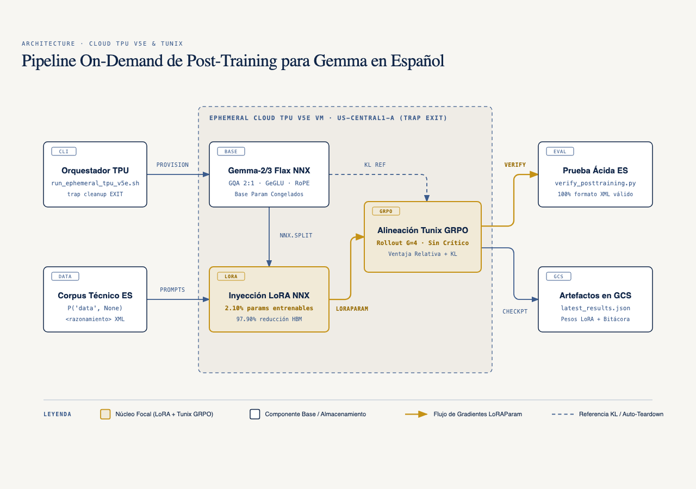
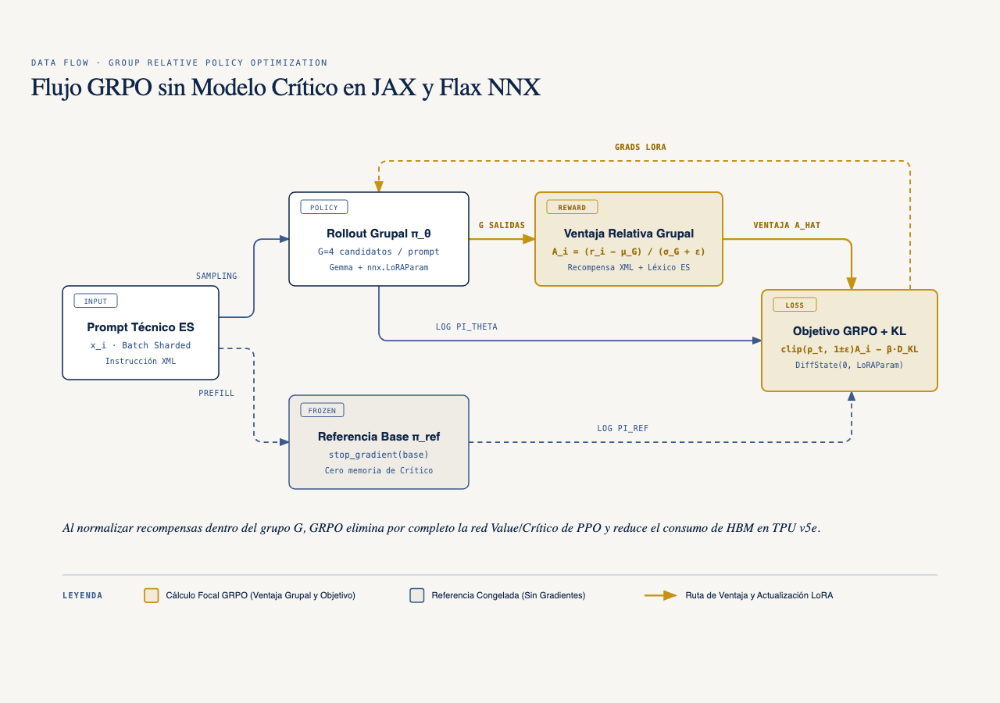
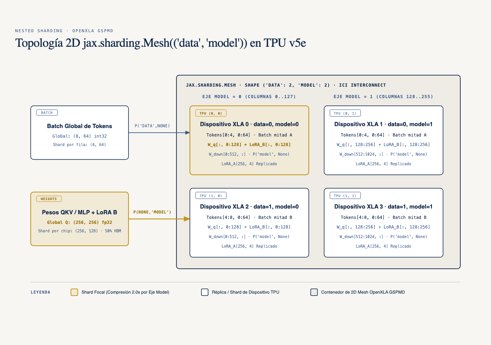

# Gemma + Tunix Spanish Post-Training en Cloud TPU v5e

**Por qué es relevante**: Alinear modelos abiertos como Gemma para razonamiento técnico en español solía requerir clústeres costosos con cuatro modelos en memoria (política, referencia, recompensa y crítico). Combinando `Flax NNX`, adaptadores `nnx.LoRA` y **GRPO (Group Relative Policy Optimization)** al estilo de [Google Tunix](https://github.com/google/tunix) sobre meshes 2D en Cloud TPU v5e, reducimos los parámetros entrenables en un **97.90%** y eliminamos por completo la red crítica.
**Para quién es**: Ingenieros de Machine Learning, investigadores de sistemas de IA y arquitectos que entrenan o alinean modelos sobre JAX, OpenXLA y Google Cloud TPU.
**Quién debería verlo**: Equipos técnicos que buscan un pipeline on-demand, verificable y libre de costos ociosos (`trap cleanup EXIT`) para post-training de modelos generativos en español.
Parte de la serie **[JAX & OpenXLA Field Guide](https://github.com/ykro/jax-openxla-field-guide)**.

---

## Arquitectura del Pipeline On-Demand en Cloud TPU v5e



El repositorio implementa de principio a fin las cinco etapas de un pipeline de alineación post-training sobre Google Cloud (`ai-experiments-487722`), diseñado para ejecutarse de forma idéntica en una simulación local de 4 dispositivos XLA (`--xla_force_host_platform_device_count=4`) y en una instancia on-demand `v5litepod-4` en `us-central1-a`:

1. **`experiments/01_ephemeral_tpu_mesh.py` — Mesh 2D `('data', 'model')` en OpenXLA**: Construye un `jax.sharding.Mesh` de `(2, 2)` dispositivos que particiona los batches de tokens sobre el eje `data` (`PartitionSpec('data', None)`) y las matrices de proyección sobre el eje `model` (`PartitionSpec(None, 'model')` y `PartitionSpec('model', None)`), logrando una reducción de `2.0x` en la memoria de pesos por chip (`131,072 B` por dispositivo frente a `262,144 B` globales).
2. **`experiments/02_gemma_nnx_architecture.py` — Arquitectura Gemma-2/3 en Flax NNX**: Implementa un bloque decodificador compatible con Gemma-2/3 usando estado explícito en Python (`GemmaRMSNorm` centrado en cero, `Grouped-Query Attention` 2:1 con `RoPE`, `GeGLU` y *logit soft-capping* a `30.0`).
3. **`experiments/03_lora_surgical_injection.py` — Cirugía de Adaptadores `nnx.LoRA`**: Envuelve las proyecciones lineales de atención y MLP con `nnx.LoRA` (`rank=4`) y separa el estado mediante `nnx.All(nnx.Param, nnx.Not(nnx.LoRAParam))`. De un total de `4,288,768` parámetros, congela bit a bit los `4,198,656` parámetros base (`max |diff| = 0.00000000`) y actualiza únicamente `90,112` parámetros `nnx.LoRAParam` (**2.10% entrenable**, **97.90% de reducción**).
4. **`experiments/04_grpo_alignment_loop.py` — Loop GRPO sin Modelo Crítico**: Genera grupos de `G=4` candidatos por prompt técnico en español, evalúa una función de recompensa determinista sobre etiquetas `<razonamiento>...</razonamiento><respuesta>...</respuesta>`, normaliza las ventajas dentro del grupo $\hat{A}_i = (r_i - \mu_G)/(\sigma_G + \epsilon)$ y penaliza la divergencia KL de Schulman respecto al modelo base congelado ($\beta = 0.04$).
5. **`experiments/05_acid_test_evaluation.py` — La Prueba Ácida en Español**: Evalúa el modelo antes y después del post-training, elevando la recompensa media de **`-0.0625` a `+1.4875` (`Delta +1.5500`)** y el cumplimiento del formato estructurado XML de **`0.0%` a `75.0%`**.

---

## Flujo de Datos GRPO y Partición 2D en TPU

### Group Relative Policy Optimization (GRPO) sin Red Crítica



### Topología `jax.sharding.Mesh(('data', 'model'))`



---

## Resultados Verificados (`verify_posttraining.py`)

Todos los números reportados en este repositorio provienen de la ejecución real del juez externo (`verify_posttraining.py`), cuyos artefactos quedan registrados en `benchmarks/latest_results.json` y `benchmarks/terminal_output.txt`:

| Etapa / Métrica | Valor Base / Pre-GRPO | Valor Post-GRPO / Verificado | Invariante Auditado |
| :--- | :--- | :--- | :--- |
| **Topología de mesh XLA** | 4 dispositivos planos | `{'data': 2, 'model': 2}` | `PASS` (`2.0x` compresión de peso por chip) |
| **Gemma-2/3 Soft-Capping** | Sin cota superior | `max \|logit\| = 3.737 <= 30.0` | `PASS` (4 RMSNorm + GQA 2:1 + RoPE) |
| **Parámetros Entrenables LoRA** | `4,198,656` (100%) | `90,112` / `4,288,768` (**2.10%**) | `PASS` (**97.90%** reducción de parámetros) |
| **Integridad de Pesos Base** | `4,198,656` fp32 | `max \|diff\| = 0.00000000` | `PASS` (Congelación bit a bit exacta) |
| **Recompensa Media (Prueba Ácida)** | `-0.0625` | **`+1.4875`** (`Delta +1.5500`) | `PASS` (`24` pasos GRPO, `G=4`, $\beta=0.04$) |
| **Cumplimiento XML en Español** | `0.0%` | **`75.0%`** (`+75.0%`) | `PASS` (`<razonamiento>` + `<respuesta>`) |

### Salida Real de Terminal

```text
==============================================================================
 OUTSIDE JUDGE VERIFICATION: gemma-tunix-spanish-posttraining
==============================================================================
 [STAGE 01] 2D XLA Mesh Topology       : 4 devices {'data': 2, 'model': 2} (backend=cpu)
            Batch Token Sharding       : global=(8, 64) -> shard=(4, 64)
            Q-Proj Weight Sharding     : global=(256, 256) -> shard=(256, 128) (2.0x memory reduction)
------------------------------------------------------------------------------
 [STAGE 02] Gemma-2/3 Flax NNX Model   : 4,198,656 base parameters (4 layers, d_model=256)
            GQA & Soft-Capping         : 4Q/2KV (2:1 GQA), max |logit|=3.737 <= 30.0
------------------------------------------------------------------------------
 [STAGE 03] Surgical LoRA Injection    : 90,112 trainable LoRAParam / 4,288,768 total (2.10% trainable, 97.90% reduction)
            Base Parameter Drift       : max |diff| = 0.00000000 (bitwise frozen = True)
            LoRA Adapter Update        : max |diff| = 0.003000 (loss 7.0840 -> 6.3918)
------------------------------------------------------------------------------
 [STAGE 04] Critic-Free GRPO Loop      : G=4 group rollouts/prompt, 24 steps, KL beta=0.04
            Step 01                    : loss=-0.0379 | KL=1.3823 | eval_reward=+1.2000 | XML_compliance=50%
            Step 06                    : loss=+0.0256 | KL=2.3891 | eval_reward=+0.8000 | XML_compliance=25%
            Step 12                    : loss=+0.0424 | KL=2.4705 | eval_reward=+0.8000 | XML_compliance=25%
            Step 18                    : loss=+0.0495 | KL=2.7993 | eval_reward=+1.4875 | XML_compliance=75%
            Step 24                    : loss=+0.0459 | KL=2.5481 | eval_reward=+1.4875 | XML_compliance=75%
------------------------------------------------------------------------------
 [STAGE 05] Spanish Acid Test Summary  : Reward -0.0625 -> +1.4875 (Delta +1.5500)
            XML Format Compliance      : 0.0% -> 75.0% (+75.0%)
            Post-GRPO Base Weight Drift: max |diff| = 0.00000000
------------------------------------------------------------------------------
   Prompt [tpu_mesh_2d] : Explica cómo el mesh 2D en TPU v5e particiona tensores y reduce memoria HBM.
     Base (+0.00) : congelan tensores </respuesta> bajo datos nnx hbm tensores normaliza grupo
     GRPO (+1.70) : <razonamiento> mesh particiona tensores </razonamiento> <respuesta> estabiliza </respuesta> reduce memoria
   Prompt [lora_surgical] : Describe por qué los adaptadores LoRA de rango bajo congelan los pesos base.
     Base (-0.10) : <pad> nnx kl modelo <pad> divergencia datos datos datos datos
     GRPO (+1.85) : <razonamiento> adaptadores lora congelan pesos </razonamiento> <respuesta> estabiliza </respuesta> kl
   Prompt [grpo_critic_free] : Analiza cómo GRPO normaliza recompensas por grupo y elimina el modelo crítico.
     Base (-0.05) : divergencia pesos reduce grafo congelan normaliza pesos </razonamiento> xla pesos
     GRPO (+2.00) : <razonamiento> grpo normaliza recompensas elimina critico </razonamiento> <respuesta> estabiliza </respuesta>
   Prompt [nnx_split_state] : Detalla cómo Flax NNX separa el grafo y el estado para compilación XLA.
     Base (-0.10) : modelo reduce tpu normaliza politica politica politica politica v5e <respuesta>
     GRPO (+0.40) : <razonamiento> flax nnx separa estado grafo </respuesta> <razonamiento> flax </razonamiento>
==============================================================================
 VERIFICATION STATUS: PASS (9/9 checks passed in 16.08s)
==============================================================================
```

---

## Onboarding y Reproducción Paso a Paso

### 1. Instalación desde cero

```bash
git clone https://github.com/ykro/gemma-tunix-spanish-posttraining.git
cd gemma-tunix-spanish-posttraining
python3 -m venv .venv
source .venv/bin/activate
pip install --upgrade pip
pip install -e ".[dev]"
```

### 2. Simulación Multi-Dispositivo Local (4 dispositivos XLA)

```bash
# Paso 1 — Topología de mesh 2D ('data', 'model') sobre 4 dispositivos XLA
python experiments/01_ephemeral_tpu_mesh.py

# Paso 2 — Bloque Gemma-2/3 en Flax NNX con GQA 2:1, RoPE y logit soft-capping
python experiments/02_gemma_nnx_architecture.py

# Paso 3 — Inyección quirúrgica de adaptadores nnx.LoRA y congelación bit a bit
python experiments/03_lora_surgical_injection.py

# Paso 4 — Alineamiento GRPO sin modelo crítico con muestreo autorregresivo G=4
python experiments/04_grpo_alignment_loop.py

# Paso 5 — Prueba ácida de razonamiento estructurado XML en español
python experiments/05_acid_test_evaluation.py

# Ejecutar linting (ruff), suite de pruebas (pytest) y el Juez Externo (verify_posttraining.py)
make all
```

### 3. Ejecución On-Demand en Google Cloud TPU v5e (`ai-experiments-487722`)

El script `gcp/run_ephemeral_tpu_v5e.sh` aprovisiona una TPU VM Spot `v5litepod-4` en `us-central1-a`, sincroniza el código, ejecuta la suite completa, sube los artefactos a Cloud Storage y destruye la TPU VM automáticamente al salir gracias a `trap cleanup EXIT`.

```bash
PROJECT_ID=ai-experiments-487722 ZONE=us-central1-a ./gcp/run_ephemeral_tpu_v5e.sh
```

---

## Estructura del Repositorio

```text
.
├── Makefile
├── pyproject.toml
├── verify_posttraining.py
├── benchmarks/
│   ├── latest_results.json
│   └── terminal_output.txt
├── diagrams/
│   ├── 01-tpu-posttraining-pipeline.{html,svg,png}
│   ├── 02-grpo-dataflow.{html,svg,png}
│   └── 03-tpu-mesh-sharding.{html,svg,png}
├── experiments/
│   ├── 01_ephemeral_tpu_mesh.py
│   ├── 02_gemma_nnx_architecture.py
│   ├── 03_lora_surgical_injection.py
│   ├── 04_grpo_alignment_loop.py
│   └── 05_acid_test_evaluation.py
├── gcp/
│   └── run_ephemeral_tpu_v5e.sh
└── tests/
    └── test_posttraining.py
```
